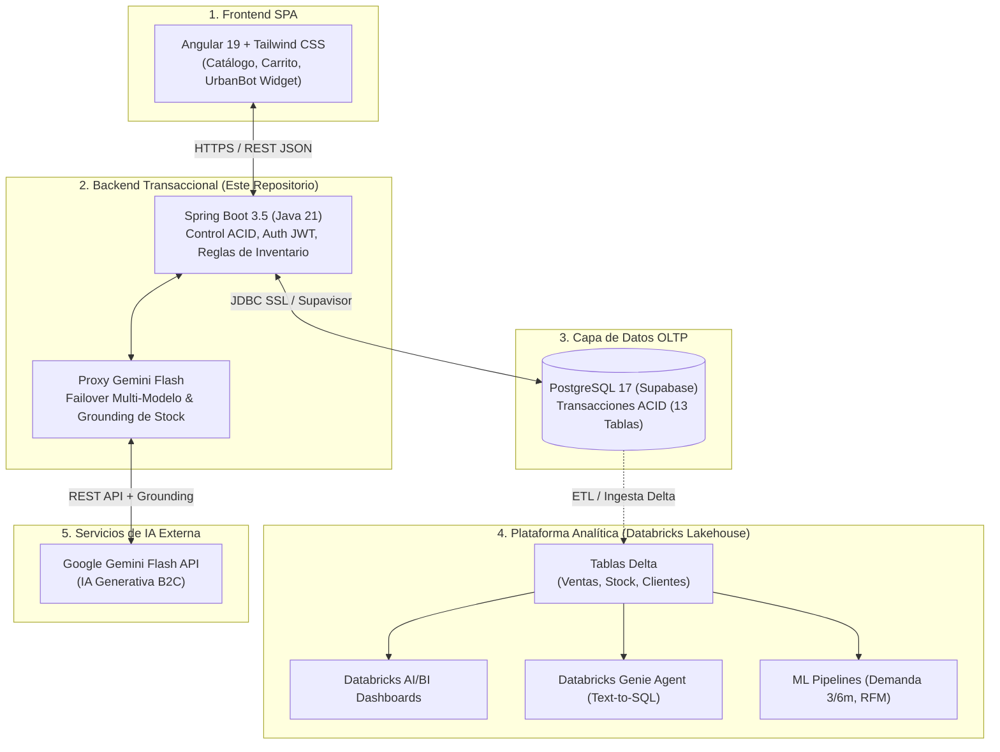

# 👟 UrbanFeet — Backend API Transaccional & AI Proxy

API RESTful robusta y motor de reglas de negocio para la plataforma de comercio electrónico de calzado deportivo y urbano **UrbanFeet**. Desarrollada como parte del curso de **Innovación y Transformación Digital (UTP - Ciclo 2026)**.

---

## 🌐 Accesos Rápidos y Despliegue en la Nube

| Recurso | Enlace / Acceso | Estado |
| :--- | :--- | :--- |
| **Frontend Web (Producción)** | 🔗 [https://ind-urban-feet-frontend.onrender.com](https://ind-urban-feet-frontend.onrender.com) | `Online` |
| **Backend REST API (Producción)** | 🔗 [https://ind-urban-feet-backend.onrender.com/api](https://ind-urban-feet-backend.onrender.com/api) | `Online` |
| **Repositorio Backend (GitHub)** | 🔗 [https://github.com/Renzito0637d/IND-urban-feet-backend.git](https://github.com/Renzito0637d/IND-urban-feet-backend.git) | `develop` |
| **Repositorio Frontend (GitHub)** | 🔗 [https://github.com/Renzito0637d/IND-urban-feet-frontend.git](https://github.com/Renzito0637d/IND-urban-feet-frontend.git) | `develop` |

### 🔑 Credenciales Demo para Evaluación de Jurado

* **Usuario Cliente (B2C):** `cliente@urbanfeet.com` / Contraseña: `Cliente123*`  
  *(Permite navegar, interactuar con el asistente virtual UrbanBot, agregar al carrito y comprar).*
* **Usuario Administrador:** `admin@urbanfeet.com` / Contraseña: `Admin123*`  
  *(Acceso al panel gerencial, control de inventario, variación de stock y pedidos).*

> [!NOTE]  
> **Comportamiento FinOps (Render Free Tier):** Si el servidor no ha recibido tráfico en los últimos 15 minutos, el contenedor entra en modo de reposo (*spin-down*). La primera petición HTTP puede tardar entre 30 y 45 segundos mientras se reactiva automáticamente.

---

## 📊 Matriz de Tecnologías y Herramientas del Proyecto

| Capa Arquitectónica | Tecnología / Herramienta | Rol en la Solución |
| :--- | :--- | :--- |
| **Lógica Transaccional (API)** | **Spring Boot 3.5.x (Java 21)** | Arquitectura RESTful, control de concurrencia ACID, seguridad stateless con JWT y cookies HttpOnly. |
| **Base de Datos Operacional** | **PostgreSQL 17 en Supabase** | Fuente única de verdad transaccional (13 tablas normalizadas) con Connection Pooling (Supavisor) y SSL obligatorio. |
| **Asistente Virtual Clientes (B2C)** | **Google Gemini Flash API** | Agente de IA para recomendación de calzado, asesoría de tallas y *grounding* en tiempo real del inventario con tarjetas interactivas. |
| **Plataforma Analítica & Lakehouse** | **Databricks Lakehouse** | Ingesta ETL y almacenamiento en tablas Delta para análisis centralizado de ventas, inventario y clientes. |
| **Inteligencia de Negocios (BI)** | **Databricks AI/BI Dashboards** | Tableros interactivos gerenciales (*«UrbanFeet — Ventas, Stock y Clientes»*) con filtros temporales y regionales. |
| **Agente Inteligente de Negocios (B2B)** | **Databricks Genie Agent** | Agente de IA con soporte de lenguaje natural (Text-to-SQL / Text-to-Viz) para consultas administrativas instantáneas. |
| **Machine Learning / Predictivo** | **ML Pipelines en Databricks** | Modelos de series temporales para proyección de demanda a 3 y 6 meses, segmentación RFM y riesgo de fuga (*churn*). |
| **Infraestructura Cloud & FinOps** | **Docker + Render PaaS** | Despliegue en contenedor OCI Alpine Linux optimizado para JVM (`-Xmx320m`, `-XX:+UseSerialGC`) con TCO de \$0.00. |

---

## 🏗️ Arquitectura General del Ecosistema



---

## 🧠 Capacidades y Reglas de Negocio Implementadas

1. **Gestión de Stock Concurrente (No Sobreventa):**
   * Validación en base de datos al momento de crear el pedido. Descuenta unidades atómicamente por variación (talla/color) con `@Transactional` y rollback ante fallos.
2. **Conciliación Financiera de KPIs:**
   * Las métricas gerenciales y reportes excluyen automáticamente pedidos en estado `CANCELADO` o `REEMBOLSADO` para reflejar solo ingresos reales.
3. **Agente Asistente Virtual B2C (UrbanBot con Gemini Flash):**
   * Proxy seguro que protege las API Keys en el servidor.
   * **Grounding en vivo:** Consulta el catálogo de PostgreSQL antes de invocar a Gemini para responder únicamente con calzado disponible.
   * **Tarjetas interactivas:** Detecta etiquetas técnicas `[VER_PRODUCTO:ID]` y devuelve objetos estructurados para que el frontend abra directamente el modal del producto.
   * **Alta disponibilidad:** Timeouts estrictos (5s conexión, 12s lectura) y *failover* automático al modelo de respaldo ante picos de demanda 503.
4. **Seguridad Stateless (Spring Security 6):**
   * Emisión y validación de tokens JWT (JJWT 0.12.x). Endpoints públicos protegidos con control granular por roles (`ROLE_ADMIN`, `ROLE_CLIENTE`, `ROLE_VENTAS`, `ROLE_INVENTARIO`).

---

## 🔌 Resumen de Endpoints Principales (REST API)

| Método | Endpoint | Acceso | Descripción |
| :--- | :--- | :--- | :--- |
| `POST` | `/api/auth/login` | Público | Autenticación de usuarios y entrega de JWT en cookie/body |
| `GET` | `/api/auth/me` | Público / Auth | Retorna información del perfil del usuario autenticado |
| `GET` | `/api/zapatilla/public/list` | Público | Catálogo con filtros dinámicos (marca, talla, precio) y paginación |
| `GET` | `/api/zapatilla/{id}` | Público | Detalle de zapatilla y variaciones para el modal interactivo |
| `POST` | `/api/chat` | Público | Consulta al Asistente Virtual UrbanBot con catálogo en tiempo real |
| `GET` | `/api/carrito` | Cliente | Obtiene el carrito activo del usuario con validación de stock |
| `POST` | `/api/pedido` | Cliente | Procesa compra transaccional ACID y descuenta inventario |
| `GET` | `/api/admin/ventas/**` | Admin | Reportes gerenciales y exportación tipificada en PDF / Excel |
| `POST` | `/api/reclamacion` | Público | Registro formal normativo en el Libro de Reclamaciones |

---

## 🛠️ Ejecución Local

### Prerrequisitos
* **Java 21** (JDK 21+)
* **Maven 3.9+** (o usar el wrapper incluido `./mvnw`)
* Base de datos PostgreSQL local o conexión a Supabase

### 1. Variables de Entorno (`.env`)
Crear un archivo `.env` en la raíz de `IND-urban-feet-backend/` basándose en `.env.example`:

```properties
DB_URL=jdbc:postgresql://db.[TU-PROYECTO].supabase.co:5432/postgres?sslmode=require
DB_USERNAME=postgres
DB_PASSWORD=tu_password_supabase

JWT_SECRET=tu_clave_secreta_jwt_base64_minimo_256_bits
JWT_ACCESS_EXP_SECONDS=3600

PORT=8080
SERVER_SERVLET_CONTEXT_PATH=/api

# Google Gemini Flash API (UrbanBot)
GEMINI_API_KEY=tu_api_key_de_google_ai_studio
```

### 2. Compilar y Ejecutar
```bash
# Compilar sin pruebas
./mvnw clean compile -DskipTests

# Iniciar servidor Spring Boot
./mvnw spring-boot:run
```
La API estará disponible en `http://localhost:8080/api`.
